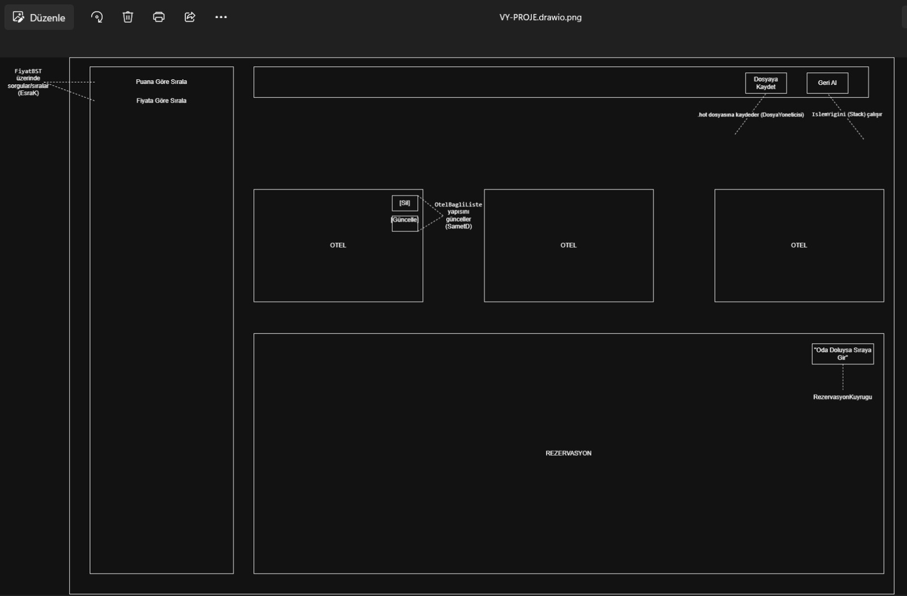
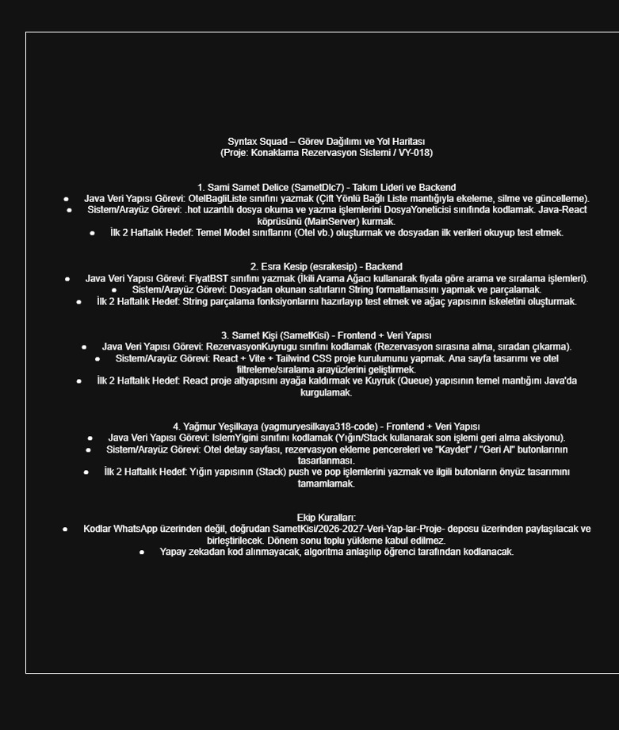

# 🏨 Otel Konaklama  Rezervasyon Sistemi
## SYNTAX SQUAD
### Veri Yapıları Projesi

* 
Otel ve rezervasyon işlemlerinin kayıtlarının yönetimi, fiyat bazlı sıralama, işlem geçmişi ve dosya kalıcılığı sağlayan backend sistemi.

---

## 🛠️ Kullanılan Veri Yapıları ve Modüller

* **Çift Yönlü Bağlı Liste (`OtelBagliListe` & `OtelNode`):** Otellerin dinamik olarak bellekte tutulması, yeni otel eklenmesi, ID bazlı silme ve güncelleme işlemleri.

* **İkili Arama Ağacı - BST (`FiyatBST` & `TreeNode`):** Otellerin fiyatlarına göre ağaç yapısında konumlandırılması ve *In-Order Traversal* ile en ucuzdan en pahalıya sıralanması.

* **Yığın - Stack (`IslemYigini`):** Sistemdeki işlemlerin LIFO (Son Giren İlk Çıkar) mantığıyla kaydedilmesi ve son işlemin geri alınabilmesi.

* **Kuyruk - Queue (`RezervasyonKuyrugu`):** Müşteri rezervasyon taleplerinin FIFO (İlk Giren İlk Çıkar) sırasıyla işlenmesi.

* **Dosya Yönetimi (`DosyaYoneticisi`):** Verilerin özel `.hot` uzantılı dosyaya `BufferedWriter` ile kaydedilmesi ve program açıldığında `BufferedReader` & `split` mantığıyla nesnelere dönüştürülerek geri yüklenmesi.

---

## 📊 Proje Görselleri ve Mimarisi

  <h3>1. : Sınıf ve Nesne Mimarisi (UML)</h3>
  

 

  <h3>2. : Arayüz ve Sistem Taslağı</h3>
  

 

  <h3>3. : Ekip Görev Dağılımı</h3>
  

---

## 👥 Proje Ekibi ve Sorumlulukları İlk Hafta.

* **Samet D.** - *Takım Lideri & Backend | Frontend:* Çift Yönlü Bağlı Liste (`OtelBagliListe`), Kalıtım Mimarisi (`TemelKayit`, `Otel`) ve Dosya Yönetimi (`DosyaYoneticisi` / `.hot` I/O).

* **Esra K.** - *Backend | Frontend:* İkili Arama Ağacı  ve Fiyat Sıralama Algoritması. (`FiyatBST`, `TreeNode`)

* **Yağmur Y.** - *Frontend | Backend:* Yığın Veri Yapısı ve Arayüz Geliştirme. (`IslemYigini`, `StackNode`)

* **Samet K.** - *Frontend | Backend:* Kuyruk Veri Yapısı ve Arayüz Geliştirme. (`RezervasyonKuyrugu`) 